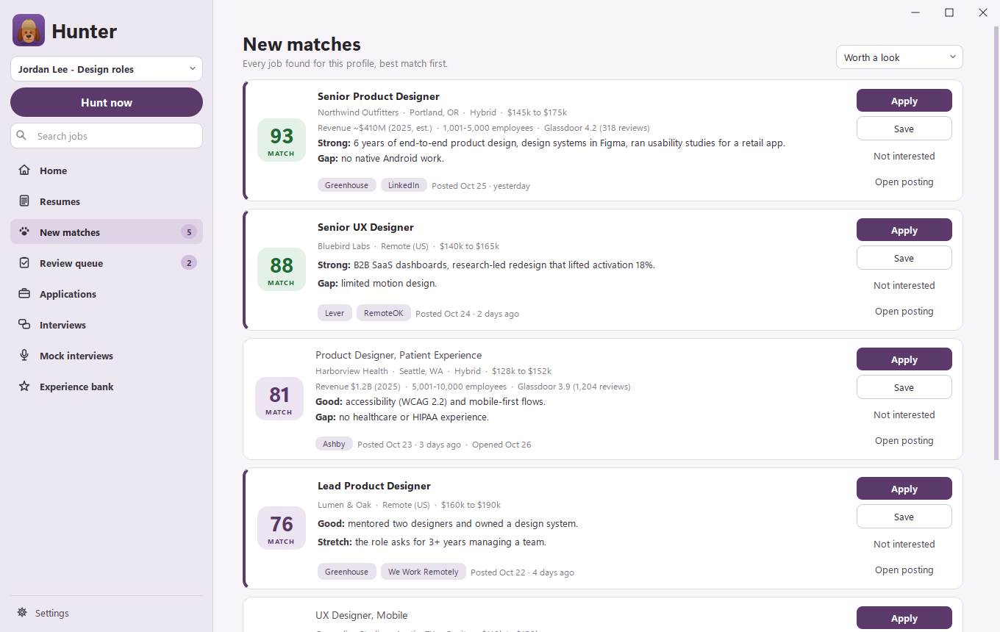
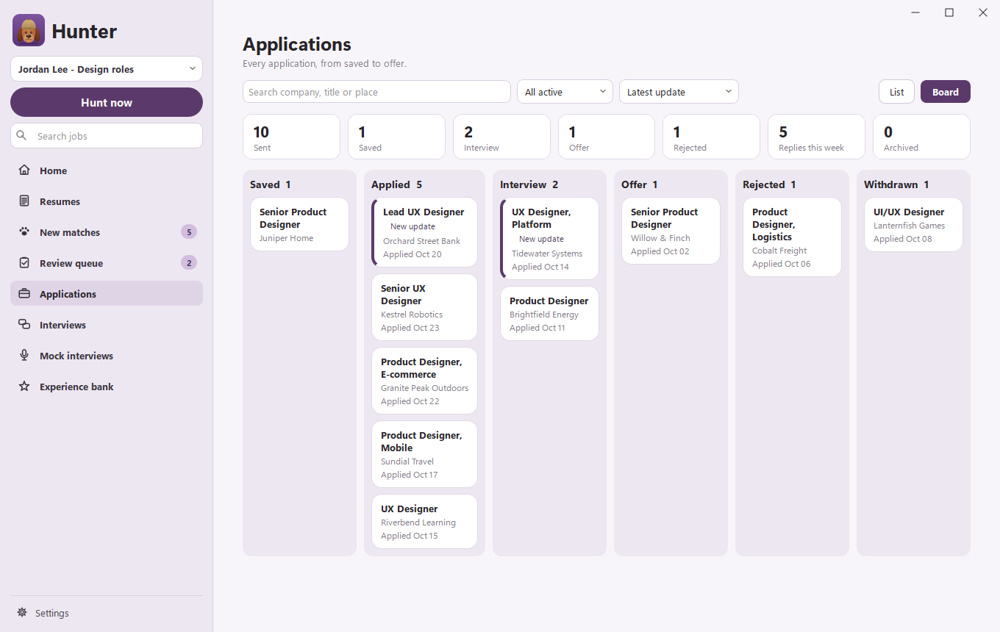

<h1 align="center">Hunter</h1>

<b>Good hunting.</b> A job-hunting app for Windows, made by Soggy Dog Studios

<a href="https://github.com/Soggy-Dog-Studios/hunter/releases/latest/download/HunterSetup.exe"><b>Download Hunter for Windows</b></a> · <a href="https://github.com/Soggy-Dog-Studios/hunter/releases">What's new</a>

## What it does

- **Finds jobs** on job boards and company career sites, on a schedule or with Hunt now. Duplicates are merged.
- **Scores every job** against your experience, with the strengths and gaps behind the score.
- **Writes a resume for each job** only from your real experience, and highlights every line it reworded.
- **Helps you apply** by filling in the application on the company's own site. Practice mode stays on until you
  turn it off, so Hunter never presses Submit on its own.
- **Tracks your applications** from applied to offer, and reads replies and interview invites from your Gmail.
- **Gets you ready:** interview prep sheets and mock interviews with an AI interviewer, typed or out loud.

## Install

1. Download **HunterSetup.exe** from the link above and open it.
2. Hunter installs just for you (no administrator rights needed) and walks you through setting up your profile.

Hunter uses your own Claude or ChatGPT plan for scoring and writing. It updates itself: Settings > About checks for
new versions. Every update is signed by Soggy Dog Studios, and Hunter won't install one that isn't.

Needs Windows 10 or 11.

## Your data

Your resumes, experience and saved logins stay on your computer. Logins are locked with a master password that's
never saved.

## Questions

Visit [soggydogstudios.com](https://soggydogstudios.com).

---

Hunter is free to use under its license (shown in Settings > About). The source code isn't public.
